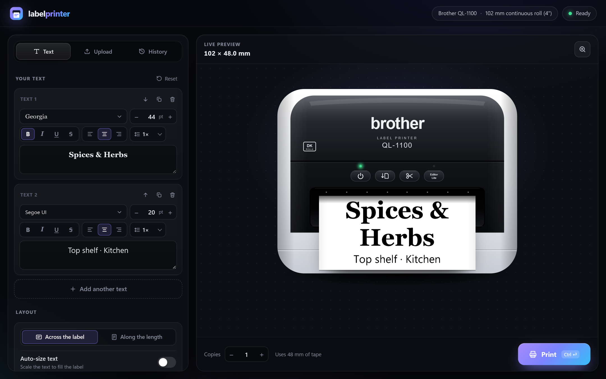
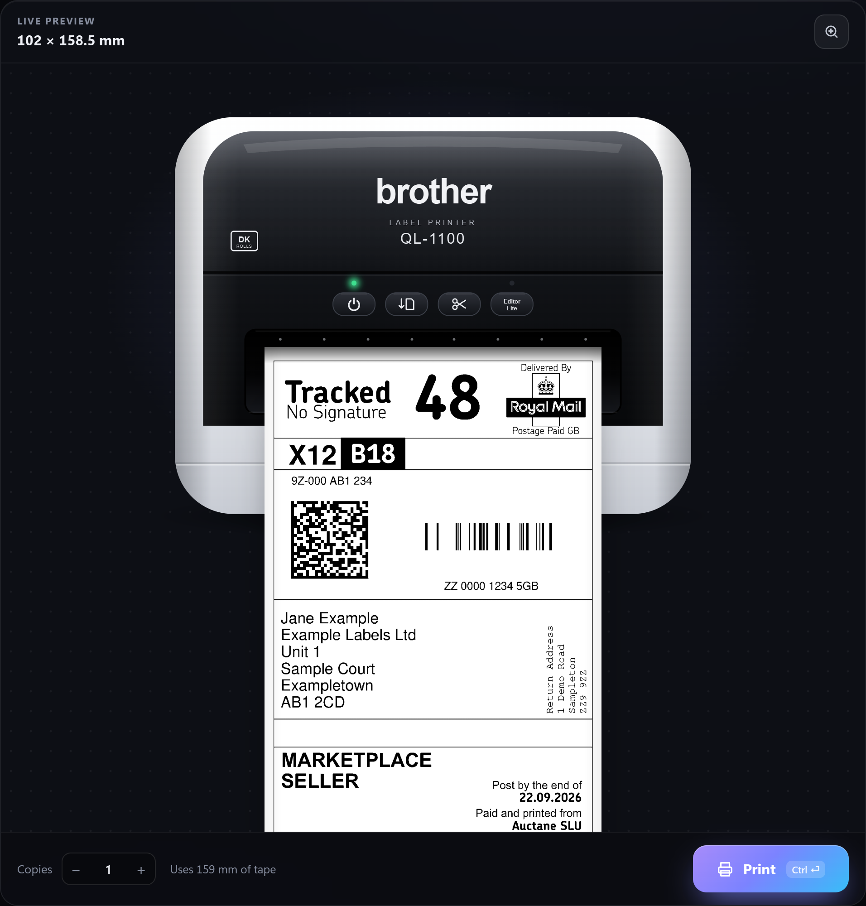
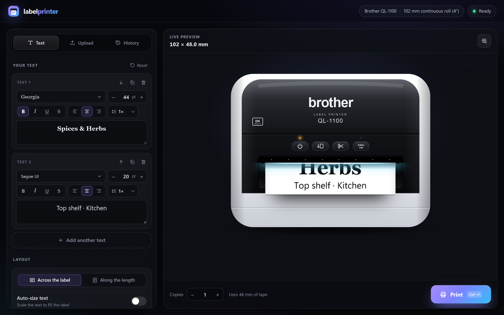
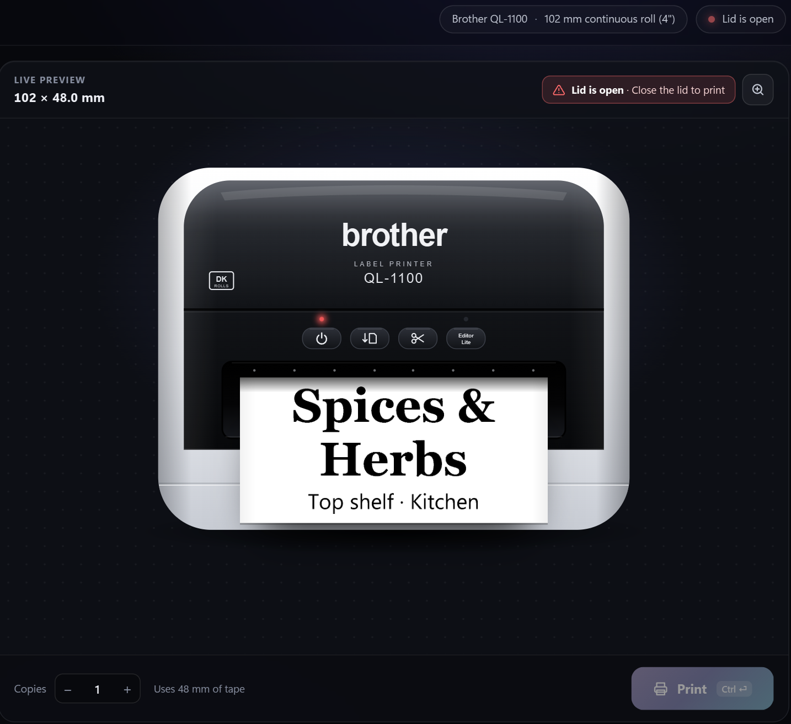
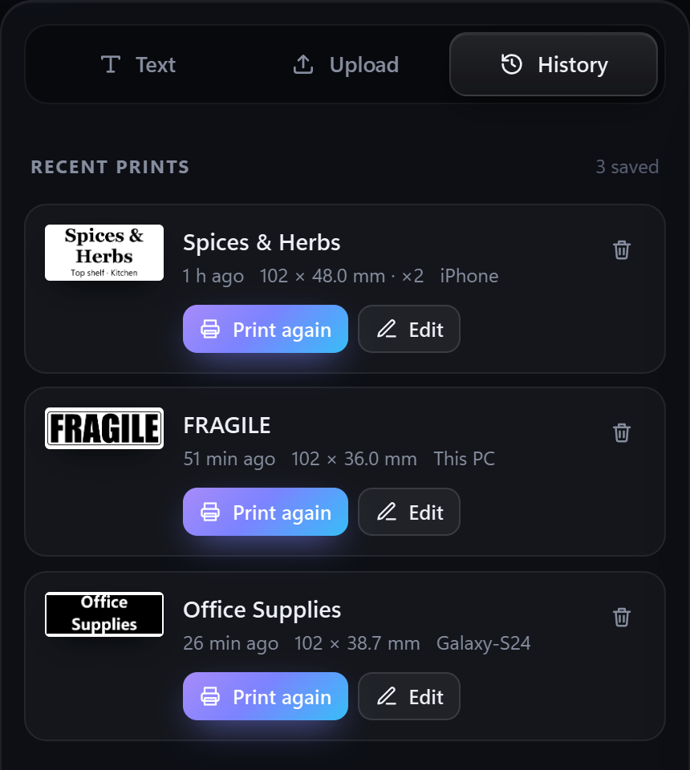
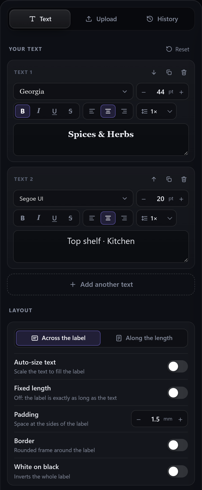
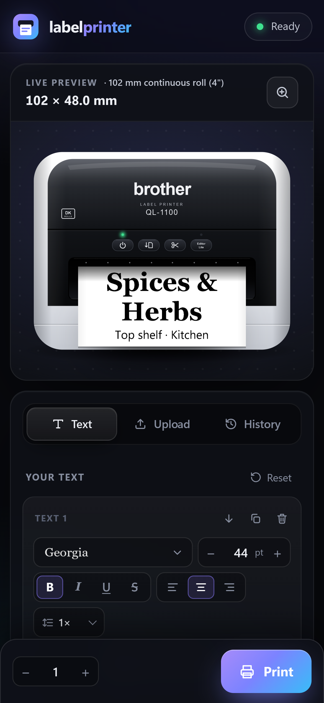

# Brother QL-1100 Label Website LAN

**A complete label-printing website for the USB Brother QL-1100 that replaces Brother's own P-touch software.** Design text labels, print shipping labels from a PDF or photo, and see exactly what will come out before you print, all in your browser.

It runs quietly on the Windows PC the printer is plugged into and starts by itself when you turn the PC on, so it's always ready at **http://labelprinter.local**. Use it on that PC, or on any phone, tablet or computer on your home Wi-Fi: nothing needs installing on them, no drivers, apps or Brother software.

The on-screen printer works like the real one too: its **Feed** button pushes out blank tape and its **Cut** button fires the printer's blade, exactly like pressing the buttons on the device.



> **Brother QL-1100 only.** It's built for the USB QL-1100 and uses Brother's own print-head layout for it. Other models, including the Wi-Fi QL-1110NWB/1115NWB, aren't supported.

## Features

- **Live preview that matches the print exactly.** It's drawn at the printer's real 300 dpi, with the real margins.
- **Text labels** using any font installed on the PC (the font picker shows each one in its own style), plus size, bold, italic, underline, strikethrough, alignment and line spacing. Text can run across the label or along its length. Auto-size, a border with adjustable thickness, and white-on-black are also available.
- **Fast or Best quality.** Fast prints noticeably quicker, exactly like Brother's own driver; Best takes extra care over every line. The print bar shows how much tape a print uses and roughly how long it will take.
- **No wasted tape.** Continuous labels are cut right after the content, down to the QL-1100's 25 mm minimum. Every label is cut automatically.
- **Shipping labels.** Upload a PDF or image (drag and drop or paste works too). It trims, rotates and fits the label to the roll, and you can crop to the part you want. Multi-page PDFs print one label per page.
- **Vinted A4 sheets fixed automatically.** Vinted's InPost labels come as an A4 sheet with instructions and a cut line. The site recognises these sheets by reading the PDF's text: an A4 page that mentions InPost and has the print/cut instructions. It works whatever the file is called. It crops the sheet to just the postage label and turns it upright, rendering it from the PDF at full quality so barcodes scan.
- **Detects the loaded roll.** It reads the printer directly over USB, so the whole site adapts to whatever DK roll is in: 12–103 mm continuous, die-cut (for example 102×152 or 62×29) and round labels.
- **Live printer status.** It shows when there are no labels, the lid is open, the roll ran out, there's a cutter jam, or the printer is off. Printing is blocked with a clear message instead of failing silently.
- **History.** Your last 100 prints, with true-size thumbnails, a zoomable close-up, and one-click print again or edit.
- **Print animation.** The label feeds out of a drawn QL-1100 at the printer's real speed.
- **Working Feed and Cut buttons.** Click the Feed and Cut buttons on the drawn printer and they act exactly like the buttons on the real QL-1100. **Feed** pushes blank tape out without cutting (handy after loading a new roll), and you can watch it hang out of the printer. **Cut** cuts instantly with the printer's own cutter, with no printing and no wasted tape. Nothing extra is needed, because these commands are built into the printer.
- **Works on phones.** The layout is responsive and dark-themed.
- **Light on resources.** It uses about 40 MB of RAM and almost no CPU when idle. It starts within seconds of logging in to Windows and restarts itself if it ever crashes.

## Screenshots

<table>
  <tr>
    <th width="50%">Shipping label upload</th>
    <th width="50%">Print animation</th>
  </tr>
  <tr>
    <td valign="top"></td>
    <td valign="top"></td>
  </tr>
  <tr>
    <th width="50%">Printer problems are shown live</th>
    <th width="50%">History</th>
  </tr>
  <tr>
    <td valign="top"></td>
    <td valign="top"></td>
  </tr>
  <tr>
    <th width="50%">Text printing</th>
    <th width="50%">On a phone</th>
  </tr>
  <tr>
    <td valign="top"></td>
    <td valign="top"></td>
  </tr>
</table>

## Requirements

- A Windows 10 or 11 PC that stays on, with the **Brother QL-1100 connected by USB**.
- Brother's **QL-1100 printer driver**, installed with the default printer name `Brother QL-1100`. Get it from [support.brother.com](https://support.brother.com).
- **Python 3.10 or newer** from [python.org](https://www.python.org/downloads/). During setup, tick **"Add python.exe to PATH"**.
- The printer's **Editor Lite light must be off**. (Editor Lite mode hides the printer from Windows.)

## Install

1. Download this project: click **Code → Download ZIP** above and unzip it somewhere permanent, for example `C:\labelprinter`. Or clone it:
   ```bash
   git clone https://github.com/Adaaks/brother-ql1100-label-website-lan.git C:\labelprinter
   ```
2. Double-click **`install.bat`**. It:
   - creates a private Python environment and installs the packages,
   - sets the server to start (hidden) a few seconds after you log in to Windows,
   - asks for admin once to allow it through Windows Firewall on your **private** network,
   - starts the server.
3. Open **http://labelprinter.local** on any device on the same network.

If a device can't resolve `labelprinter.local` (some older Android phones), use the PC's IP address instead, for example `http://192.168.1.50`. Run `ipconfig` on the PC to find it. Giving the PC a fixed IP in your router keeps that address from changing.

## Everyday use

| File | What it does |
|---|---|
| `start.bat` | Starts the server, which also starts automatically when you log in |
| `stop.bat` | Stops it |
| `allow-firewall.bat` | Re-adds the firewall rule (run as admin) |
| `uninstall.bat` | Stops it and removes it from startup and the firewall |
| `logs\server.log` | Log file, if something goes wrong |

The server runs while you're logged in to Windows. If the PC sleeps, the site is unavailable until it wakes.

## Troubleshooting

- **The page doesn't open from another device.** Make sure the PC's network is set to *Private*, then run `allow-firewall.bat` as administrator.
- **"Printer is off or unplugged".** Check the USB cable and power, and make sure the Editor Lite light is off.
- **"Printer 'Brother QL-1100' isn't installed".** Install Brother's driver and keep the default printer name.
- **Port 80 is already in use by another program.** The server falls back to port 8080, so open `http://labelprinter.local:8080`.

## How it works

A Python [Flask](https://flask.palletsprojects.com/)/[waitress](https://docs.pylonsproject.org/projects/waitress/) server renders every label with Pillow, at the exact dot size Brother's *QL-1100 Raster Command Reference* specifies for the loaded roll. Jobs go to the printer as raw Brother raster data through the Windows print spooler. Printer status and the loaded roll are read straight from the printer's USB interface. The `labelprinter.local` name is announced with mDNS (zeroconf).

Raster encoding uses [brother_ql-inventree](https://pypi.org/project/brother-ql-inventree/), and PDFs are read with [PyMuPDF](https://pymupdf.readthedocs.io/).

*Not affiliated with Brother Industries. "Brother" and "QL-1100" are trademarks of their respective owners.*
